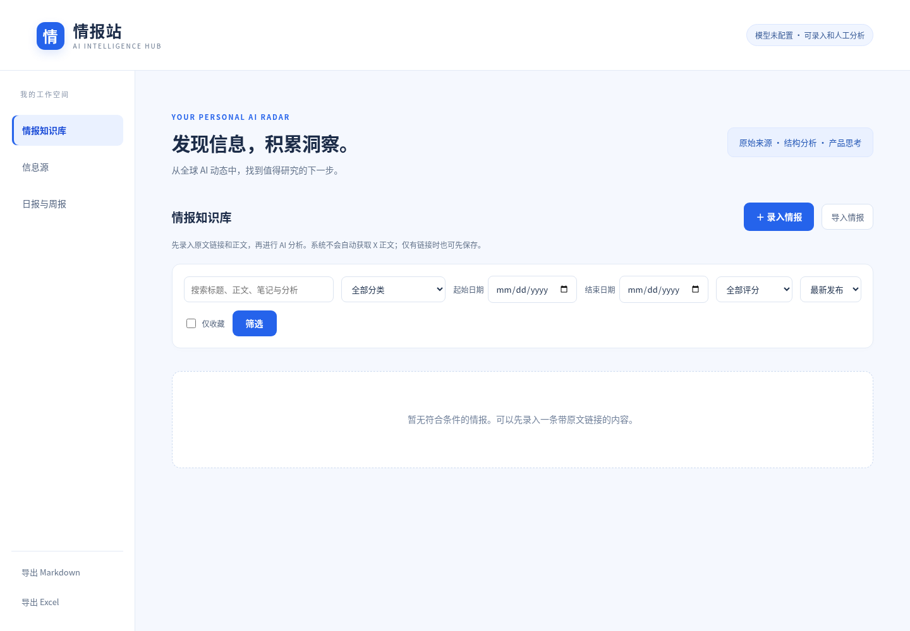

# 情报站 · AI Intelligence Hub

个人 AI 情报知识库：把原文转化为摘要、分类、评分和产品经理思考。简单本机 MVP，Python 3.10+，FastAPI + SQLite WAL + 原生 HTML/CSS/JavaScript。

## 页面预览

蓝白主题，桌面侧边导航与双列情报卡片，手机采用单列布局。截图为空知识库状态，不含虚构情报。



## 本机启动（macOS / Linux）

需要可直接访问的HTTPS网站时，见[Render部署步骤](docs/Render部署.md)。仓库包含部署配置和单用户登录保护；需要在自己的Render账号创建服务，配置采用付费服务与持久磁盘，创建前核对费用。此说明不代表网站已部署。

```sh
git clone https://github.com/liuchen2608/qingbaozhan.git
cd qingbaozhan
sh setup.sh
.venv/bin/python run.py
```

在浏览器打开 `http://127.0.0.1:8765`。按 Ctrl+C 停止。macOS 也可在初始化后使用 `启动情报站.command`；若系统阻止，请先使用上述终端命令。尚未在真实 Mac 上验证脚本。

希望放在桌面时，可把仓库克隆到 `~/Desktop/情报站`，**仅在该目录不存在时执行**：

```sh
git clone https://github.com/liuchen2608/qingbaozhan.git "$HOME/Desktop/情报站"
```

已有该文件夹时不要覆盖 `.env` 或 `data/`，先备份并检查内容。GitHub推送、云端发布和下载到Mac是三个不同动作；本仓库存在不代表已交付到你的Mac。

## 配置模型

`setup.sh`只在`.env`不存在时从模板创建，不覆盖已有配置。编辑服务端`.env`后重启：

```dotenv
MODEL_PROVIDER=openai
MODEL_BASE_URL=https://api.openai.com/v1
MODEL_ID=填写你有权限使用的模型ID
MODEL_API_KEY=填写自己的密钥
MODEL_TIMEOUT=90
```

OpenAI兼容接口的BASE_URL应包含服务商要求的版本前缀（例如`/v1`），程序追加`/chat/completions`。Anthropic使用`MODEL_PROVIDER=anthropic`、`MODEL_BASE_URL=https://api.anthropic.com`，程序追加`/v1/messages`。仅支持HTTPS，不自动重试付费请求。模型配置仅在服务器读取，不通过网页返回。

首次真实分析前确认服务商的数据与费用政策，原文会发往你配置的接口。没有密钥时可管理信息源、录入、导入、检索、人工分析、报告与导出，不能生成真实AI分析。配置状态不代表真实调用已通过。

## 使用流程

1. 在“信息源”添加名称和主页，或导入自己的清单。不预置未经确认的账号。
2. “录入情报”填写标题、原文链接、作者、北京时间、正文，可关联信息源和写笔记。
3. 点击“AI分析”；仅保存链接时需要先补充正文，不会自动抓取推文。
4. 在“查看分析”查看证据、评分理由、产品经理八问及历史；可用人工分析表单修订。
5. 按关键词、日期、分类、最低分数、收藏筛选，按评分或时间排序。
6. “日报与周报”选择日期后生成并下载Markdown。所有报告保留来源，最多10条，少于5条不补齐；周报是已有分析的七天整理。
7. 导出全量知识库为Markdown或真正的.xlsx。导出不是完整备份，不包含分析版本历史。

编辑标题、原文、链接、作者、发布时间或关联来源后，当前分析失效，需要重新分析。编辑笔记或收藏不使分析失效。删除情报会永久删除它的分析历史，请谨慎操作。

## 导入格式

支持UTF-8 CSV、JSON对象数组、XLSX首个工作表，首行为**英文列名**。单次≤2MB、≤1000条；逐行返回成功、重复和错误，错误行不阻止其他行。XLSX解压内容≤20MB。不自动识别其他Excel列名，收到实际清单后再适配。

信息源必填 `name,url`；可选 `category,enabled`（true/false）。

```csv
name,url,category,enabled
示例来源,https://x.com/example,AI Agent,true
```

情报必填 `title,url,published_at`；可选 `content,author,source_id,notes,favorite`。时间必须含时区。空的可选列建议删除，而不是填null。

```json
[
  {
    "title": "演示记录（并非真实新闻）",
    "url": "https://example.com/ai-demo",
    "published_at": "2026-11-14T12:00:00+08:00",
    "content": "将这里替换为你有权使用的真实原文。",
    "author": "示例作者"
  }
]
```

X与Twitter同一status ID会去重；去空白后≥80字符的相同正文会去重。来源停用不会删除已有情报，也不代表后台有采集任务。

## 数据、安全与备份

默认数据在`data/hub.sqlite3`，可用`HUB_DB`环境变量指定路径。停止服务后备份整个`data/`目录及自己的`.env`到安全位置。数据库、真实.env、虚拟环境均不提交GitHub。使用SQLite运行期备份API也可备份，不要在服务运行时只复制主数据库而忽略WAL。

默认本机启动仅监听127.0.0.1，不要求登录；公网部署必须启用HUB_PUBLIC_MODE并配置登录凭证及允许的域名，使用平台HTTPS，详见Render部署说明。API文档在本机`/docs`。模型的分析和评分仍需人工核查，不代表独立事实验证或投资建议。

## 验证

```sh
.venv/bin/python -m unittest discover -s tests -v
node --check static/app.js
sh -n setup.sh
sh -n 启动情报站.command
```

测试使用独立临时数据库与模拟模型，不消耗真实API额度。实际结果和未验证项见[验收记录](docs/验收记录.md)。

## 范围与文档

- [需求基线](docs/需求.md)
- [架构方案与蓝图映射](docs/架构方案.md)
- [验收记录](docs/验收记录.md)

本版不包含X自动采集、定时任务、飞书推送／同步、跨设备同步、智能问答。后续需先验证官方或合法授权数据接口的权限、价格和限额。用户上传的agent-blueprint是方法参考包，未把其中的.env、虚拟环境或整包提交到本仓库。
