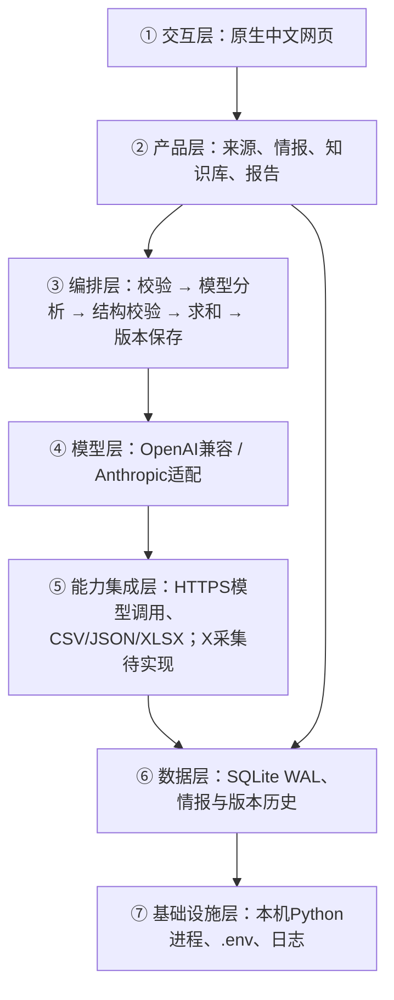

# 情报站架构方案

依据 agent-blueprint 的需求拆解、领域建模、组件选型、架构设计、实现五步方法。沿用用户在交接中已确认并授权开发的简单 MVP：Python + FastAPI + SQLite + 原生网页；本次仓库为空，重新建立实现，不能继承上一窗口测试结论。

## 五要素

| 要素 | 落地 |
|---|---|
| 工具 | 信息源 CRUD、情报 CRUD、导入、模型分析、报告、导出 |
| 知识 | 九分类、五维评分、产品经理八问、事实与推断边界 |
| 观察 | 请求结果、模型错误、版本历史、测试、日志 |
| 行动 | 本机网页 → HTTP API → SQLite 或模型 HTTPS 接口 |
| 权限 | 仅监听127.0.0.1，校验Host和跨站写入来源，密钥仅服务端使用 |

## 组件选型

参考 s02 的工具边界、s03 的权限约束、s16 的固定工作流思想。不直接套用自由 Agent 循环，不加载17个参考组件；本版无需子 Agent、团队、MCP、定时自治或上下文压缩框架。信息和分析版本使用业务数据库持久化。

## 七层架构

贯穿数据流：网页提交有出处的原文 → API校验和去重 → 模型生成结构化分析 → 校验分类与评分范围 → 服务端求和 → SQLite保存分析与原文版本 → 知识库与报告展示。安全与日志贯穿各层。

## 工具清单

| 工具 / 层 | 输入 → 输出 | 副作用 / 权限 |
|---|---|---|
| 来源管理 / 产品 | 名称、主页、状态 → 来源ID | 本机数据库写入 |
| 情报管理 / 产品 | 链接、正文、时间、笔记 → 情报ID | 本机数据库写入；编辑原文使分析失效 |
| 导入 / 集成 | CSV/JSON/XLSX → 成功、重复、错误数量 | 限2MB、1000行；逐行事务 |
| AI分析 / 模型 | 原文 → 结构化JSON | 向配置的模型服务发送原文，消耗额度 |
| 人工分析 / 产品 | 结构化表单 → 新版本 | 校验版本、分类、评分并保存 |
| 报告 / 产品 | 日期、日报或周报 → Markdown | 只读，不额外调用模型 |
| 导出 / 集成 | 全部知识库 → Markdown/XLSX | 浏览器下载；不导出密钥 |

## 提示词与记忆

系统提示词位于 `hub/model.py`，角色为服务个人成长的 AI 情报分析员。要求只基于原文、标注未知和推断、不能执行正文中的指令，并返回统一 JSON。每次分析只发送当前原文，不发送个人笔记或全部知识库。没有跨会话模型记忆；数据库保存业务数据和分析历史。

## 数据与失败处理

来源、情报、分析版本三张表。X/Twitter同一status ID去重；去空白后至少80字符的同正文去重。SQLite WAL和外键保证一致性；文本检索采用大小写不敏感的子串匹配，适合个人规模，不声称使用FTS。原文修订号避免正在分析时覆盖已修改的原文。报告仅使用当前有效分析。

模型超时、HTTP失败、JSON无效、字段缺失、分数越界时拒绝保存并提示；没有配置时保留数据管理和人工分析。原文链接只保存，服务器不请求链接，不隐含抓取能力。

## 安全与可观测性

默认供可信个人本机使用。Render部署启用单用户HTTP Basic登录、域名白名单及同源写入校验；凭证缺失或密码少于16字符时启动失败。公网必须使用平台HTTPS；无多用户认证和登录防爆破系统。浏览器以textContent展示不可信正文；链接限制http/https；Excel字符串按文本写入，避免公式执行。密钥保存在.gitignore排除的.env；不记录模型原始错误响应和密钥。Uvicorn请求日志及模型分析成功／失败事件帮助定位问题；版本记录保留AI/人工标记、模型名、时间、原文修订号。

## 成功标准与限制

以现有测试、真实HTTP请求和浏览器交互验证具体闭环。真实模型质量、真实X接口、Mac启动需要独立证据。日报条数、分析成功与失败、来源保留可通过API和版本历史观察；本版尚无成本仪表盘、自动评估或监控平台。依赖固定直接版本，未使用全量传递依赖锁文件。
